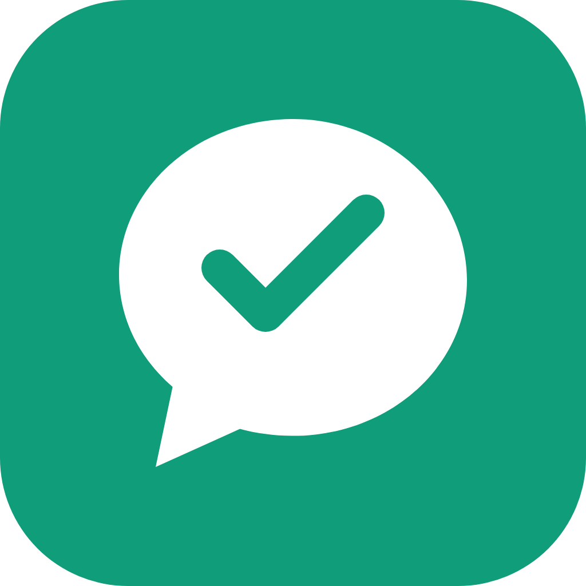
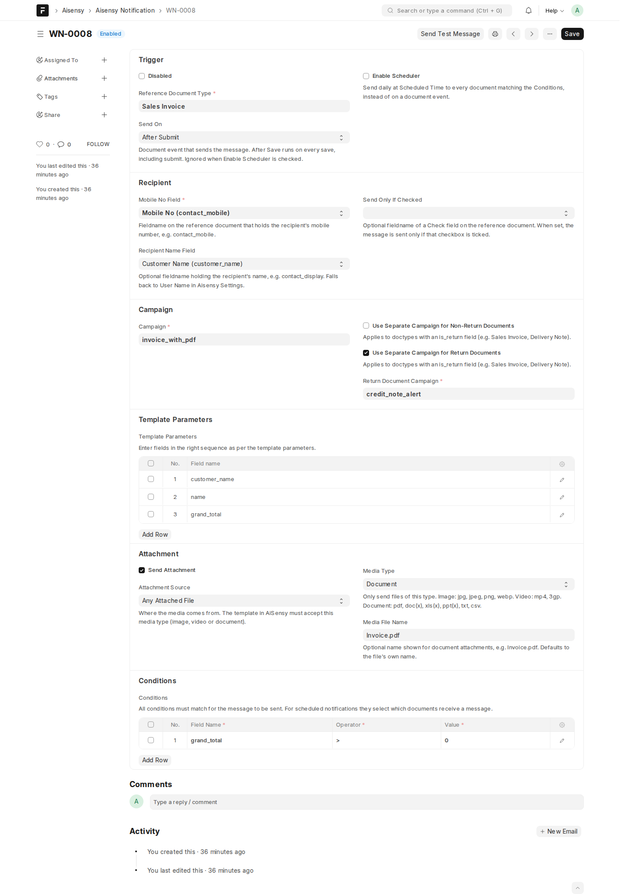
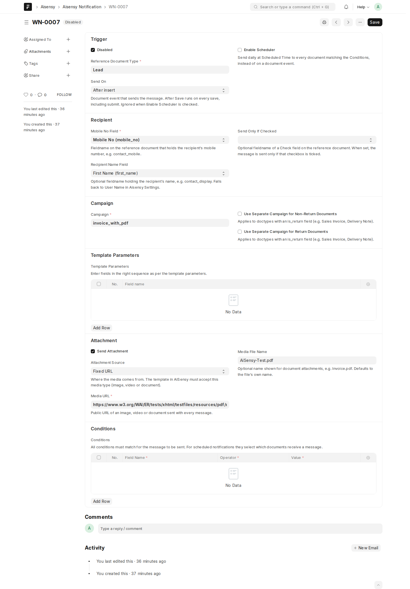
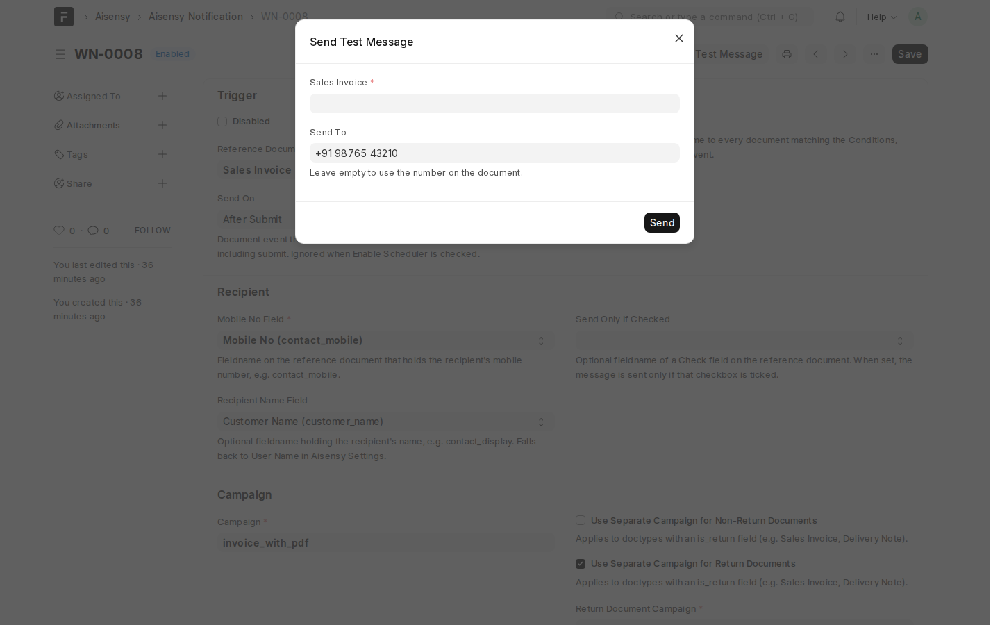
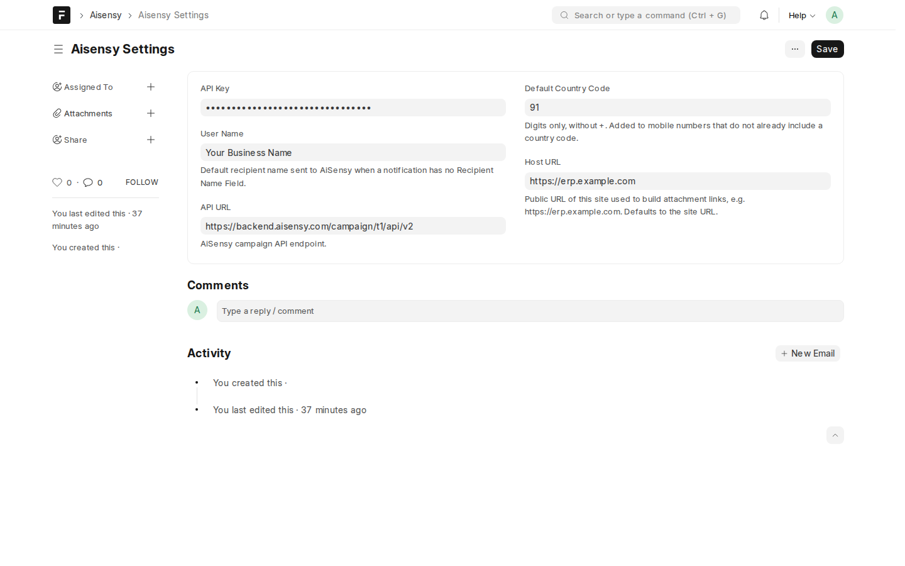
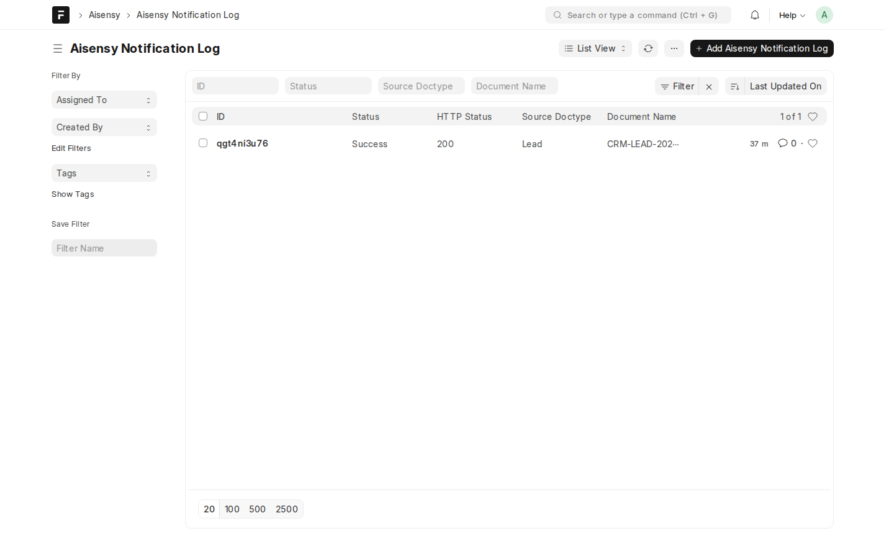
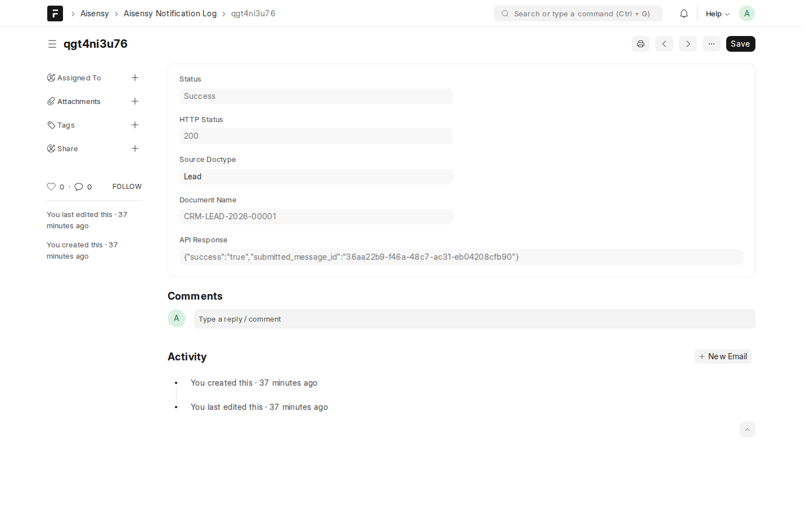
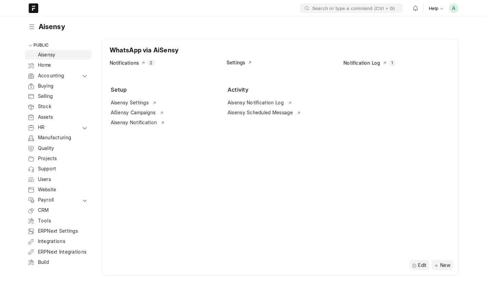

Send WhatsApp template messages through [AiSensy](https://aisensy.com) from any Frappe / ERPNext document, with no code. Choose a DocType and an event, map fields to template parameters, and messages go out automatically.

[Privacy Policy](privacy.html) · [Terms of Service](terms.html) · [Release Notes](release-notes.html) · [Support](mailto:satyabrata12017@gmail.com)

## Features

- **Any DocType:** Sales Invoice, Delivery Note, Sales Order, Lead, Customer, Issue, custom doctypes and more
- **Triggers:** After Insert, After Save, Before Submit, After Submit, After Cancel, or a daily schedule
- **Template parameters** picked from the document's fields, with no typing of fieldnames
- **Media:** images (jpg, jpeg, png, webp), videos (mp4, 3gp) or documents (PDF, office files), from an attach field, an attached file, a URL field or a fixed URL
- **Conditions:** send only when the document matches your rules (`=`, `!=`, `>`, `<`, `in`, `like`, `is set` …)
- **Opt-in checkbox:** optionally send only when a Check field on the document is ticked
- **Return documents:** separate campaign for return and non-return documents
- **Send Test Message** button to try a notification on any document
- **Notification Log** with the HTTP status and AiSensy response of every call
- Messages sent in the **background**, so users are never slowed down
- **Encrypted** API key, configurable country code

## Requirements

- Frappe **v14, v15 or v16** (ERPNext and HRMS optional)
- An AiSensy account with an API key and live API campaigns

## Installation

**Frappe Cloud:** install the app from the Marketplace on your site.

**Self-hosted** (requires access to the source repository): use the branch matching your Frappe version, `version-14`, `version-15` or `version-16`:

```bash
bench get-app https://github.com/Satyabrata12017/Ai-sensy.git --branch version-15
bench --site your-site install-app aisensy
bench --site your-site migrate
bench --site your-site enable-scheduler
```

Background workers must be running, because messages are sent from a background job.

## Setup

1. **Aisensy Settings**
   - **API Key:** from AiSensy → Manage → API Key (stored encrypted)
   - **User Name:** default recipient name sent to AiSensy
   - **API URL:** defaults to `https://backend.aisensy.com/campaign/t1/api/v2`
   - **Default Country Code:** digits only, e.g. `91`; added to numbers stored without a country code
   - **Host URL:** public URL of your site, used for attachment links (defaults to the site URL)
2. **AiSensy Campaigns:** one record per API campaign, named exactly as in AiSensy.
3. **Aisensy Notification:** one per message:
   - **Reference Document Type** and **Send On**
   - **Mobile No Field**, optional **Recipient Name Field** and **Send Only If Checked**
   - **Campaign**, plus optional separate campaigns for return / non-return documents
   - **Template Parameters:** document fields in the same order as the template placeholders
   - **Attachment:** source, media type and file name, for media templates
   - **Conditions:** all must match for the message to be sent
   - For a daily message: **Enable Scheduler**, **Scheduled Time** and at least one condition
4. Click **Send Test Message** to check the setup against a real document.

> AiSensy downloads attachments from your site, so attachment files must be **public**. Private files are not sent, and the failure is recorded in the Notification Log.

## Screenshots

**Notification on Sales Invoice with template parameters, PDF attachment and condition**


**Works on any DocType**


**Send Test Message**


**Settings**


**Notification Log**



**Workspace**


## Support

Email **satyabrata12017@gmail.com**.

## License

MIT
